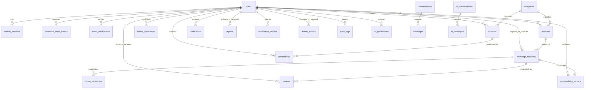

# ROOTLY HOMEGROWN PRODUCE EXCHANGE — DATABASE SCHEMA

This document details the complete 26-collection MongoDB architecture for Rootly, based on the established ER diagram and domain specifications.

---

## 1. Complete Collection Catalog (26 Collections)

---

## 2. Authentication (4 Collections)

### 1. `users`
- **Model**: `backend/models/User.js`
- **Fields**:
  - `name`: String (Required, trimmed, max 100)
  - `email`: String (Required, unique, lowercase, normalized)
  - `passwordHash`: String (bcrypt hash with 12 salt rounds)
  - `phone`: String (Optional phone for harvest coordination)
  - `role`: Enum `['USER', 'ADMIN']` (Default `'USER'`)
  - `accountStatus`: Enum `['ACTIVE', 'SUSPENDED', 'BLOCKED', 'DEACTIVATED']`
  - `preferredLanguage`: Enum `['en', 'ml']` (Default `'en'`)
  - `profile`: Embedded `{ bio, avatar, gardenName, gardenBio, interests: [String] }`
  - `location`: GeoJSON Point `{ type: 'Point', coordinates: [lon, lat], neighborhood, city, state, isExactLocationHidden }`
  - `isEmailVerified`: Boolean (Default `false`)
- **Indexes**:
  - Unique index on `email`
  - 2dsphere index on `location`
  - Compound index on `{ role: 1, accountStatus: 1 }`

### 2. `refresh_sessions`
- **Model**: `backend/models/RefreshSession.js`
- **Fields**: `userId` (ref User), `tokenHash` (SHA-256), `deviceInfo`, `expiresAt` (Date), `revokedAt` (Date)
- **TTL Index**: Automatic asynchronous cleanup via `{ expiresAt: 1 }, { expireAfterSeconds: 0 }`

### 3. `password_reset_tokens`
- **Model**: `backend/models/PasswordResetToken.js`
- **Fields**: `userId` (ref User), `tokenHash` (SHA-256), `expiresAt` (Date), `usedAt` (Date)
- **TTL Index**: Automatic cleanup after expiry via `{ expiresAt: 1 }, { expireAfterSeconds: 0 }`

### 4. `email_verifications`
- **Model**: `backend/models/EmailVerification.js`
- **Fields**: `userId` (ref User), `tokenHash` (SHA-256), `expiresAt` (Date), `usedAt` (Date)
- **TTL Index**: Automatic cleanup after expiry.

---

## 3. Marketplace (6 Collections)

### 5. `categories`
- **Model**: `backend/models/Category.js`
- **Fields**: `name`, `slug` (Unique), `description`, `icon`, `imageUrl`, `isActive`
- **Index**: Unique index on `slug`.

### 6. `products`
- **Model**: `backend/models/Product.js`
- **Fields**:
  - `sellerId`: ObjectId (ref User, indexed)
  - `categoryId`: ObjectId (ref Category, indexed)
  - `name`: String (Produce name)
  - `description`: String (max 2000)
  - `exchangeType`: Enum `['SELL', 'BARTER', 'FREE']`
  - `pricing`: `{ price: Number, unit: String, isNegotiable: Boolean }`
  - `quantity`: `{ available: Number, unit: String }`
  - `images`: Array of `{ url: String, publicId: String, position: Number }`
  - `location`: GeoJSON Point `[longitude, latitude]` with `neighborhood`, `city`, `approximateDisplay`
  - `availabilityStatus`: Enum `['AVAILABLE', 'RESERVED', 'EXCHANGED', 'OUT_OF_STOCK']`
  - `harvestStatus`: Enum `['READY_NOW', 'HARVESTING_SOON', 'JUST_HARVESTED']`
  - `organicDeclaration`: Boolean (Advisory declaration)
  - `viewsCount`: Number
- **Indexes**:
  - 2dsphere index on `location`
  - Compound `{ sellerId: 1, availabilityStatus: 1 }`
  - Compound `{ categoryId: 1, availabilityStatus: 1 }`
  - Compound `{ exchangeType: 1, availabilityStatus: 1 }`

### 7. `exchange_requests`
- **Model**: `backend/models/ExchangeRequest.js`
- **Fields**: `requesterId`, `sellerId`, `productId`, `requestType` (`BUY/BARTER/FREE`), `quantityRequested`, `offeredItems`, `offeredPrice`, `message`, `status` (`PENDING/ACCEPTED/REJECTED/CANCELLED/SCHEDULED/COMPLETED`), `completedAt`
- **Indexes**: Compound on `{ productId: 1, status: 1 }`, `{ requesterId: 1, status: 1 }`, `{ sellerId: 1, status: 1 }`.

### 8. `barter_preferences`
- **Model**: `backend/models/BarterPreference.js`
- **Fields**: `userId`, `haveCategories`, `haveProduceDescription`, `wantCategories`, `wantProduceDescription`, `maxDistanceKm`, `location` (GeoJSON), `isActive`
- **Indexes**: 2dsphere on `location`, compound `{ userId: 1, isActive: 1 }`.

### 9. `barter_matches`
- **Model**: `backend/models/BarterMatch.js`
- **Fields**: `userA`, `userB`, `preferenceA`, `preferenceB`, `matchScore` (0-100), `matchReasons`, `distanceKm`, `status`
- **Index**: Compound on `{ userA: 1, userB: 1, status: 1 }`.

### 10. `pickup_schedules`
- **Model**: `backend/models/PickupSchedule.js`
- **Fields**: `exchangeRequestId`, `buyerId`, `sellerId`, `pickupDate`, `timeSlot`, `exactPickupAddress` (Revealed only upon accepted status), `pickupLocation` (GeoJSON), `status`, `specialInstructions`
- **Index**: Compound on `{ pickupDate: 1, status: 1 }`.

---

## 4. Harvest (2 Collections)

### 11. `harvests`
- **Model**: `backend/models/Harvest.js`
- **Fields**: `growerId`, `produceName`, `categoryId`, `variety`, `plantingDate`, `expectedHarvestDate`, `estimatedQuantity` (`{ amount, unit, isAIEstimated }`), `status` (`GROWING/NEAR_HARVEST/HARVESTED/CANCELLED`), `allowsPrebooking`, `prebookingPricePerUnit`, `prebookedQuantity`
- **Indexes**: `{ growerId: 1, status: 1 }`, `{ expectedHarvestDate: 1, status: 1 }`, 2dsphere on `location`.

### 12. `prebookings`
- **Model**: `backend/models/Prebooking.js`
- **Fields**: `harvestId`, `growerId`, `buyerId`, `quantity`, `agreedPrice`, `status` (`PENDING/CONFIRMED/FULFILLED/CANCELLED`), `notes`
- **Indexes**: Compound on `{ harvestId: 1, status: 1 }`, `{ buyerId: 1, status: 1 }`.

---

## 5. Community (5 Collections)

### 13. `conversations`
- **Model**: `backend/models/Conversation.js`
- **Fields**: `participants` (Array of user ObjectIds), `lastMessage` (`{ text, senderId, createdAt }`), `exchangeRequestId`, `unreadCounts` (Map of userId to number)
- **Index**: `{ participants: 1 }`.

### 14. `messages`
- **Model**: `backend/models/Message.js`
- **Fields**: `conversationId`, `senderId`, `content`, `messageType` (`TEXT/IMAGE/LOCATION_PROPOSAL/SYSTEM`), `isRead`, `readBy`
- **Index**: Compound on `{ conversationId: 1, createdAt: 1 }`.

### 15. `reviews`
- **Model**: `backend/models/Review.js`
- **Fields**: `reviewerId`, `targetUserId`, `exchangeRequestId`, `rating` (1-5), `comment`, `produceQualityRating`, `punctualityRating`
- **Critical Unique Index**: `{ reviewerId: 1, exchangeRequestId: 1 }` (Enforces that a user can only review a completed exchange once).

### 16. `notifications`
- **Model**: `backend/models/Notification.js`
- **Fields**: `recipientId`, `senderId`, `title`, `message`, `type`, `link`, `data`, `isRead`
- **Index**: Compound on `{ recipientId: 1, isRead: 1, createdAt: -1 }`.

### 17. `reports`
- **Model**: `backend/models/Report.js`
- **Fields**: `reporterId`, `reportedUserId`, `reportedProductId`, `reason` (`COMMERCIAL_RESELLER/FALSE_ADVERTISING/NOT_HOMEGROWN/INAPPROPRIATE_BEHAVIOR/SPAM/SAFETY_CONCERN/OTHER`), `details`, `evidenceImages`, `status` (`PENDING/INVESTIGATING/RESOLVED/DISMISSED`), `resolutionNotes`, `resolvedBy`, `resolvedAt`
- **Index**: Compound on `{ status: 1, createdAt: -1 }`.

---

## 6. Administration (4 Collections)

### 18. `admin_actions`
- **Model**: `backend/models/AdminAction.js`
- **Fields**: `adminId`, `actionType` (`SUSPEND_USER/ACTIVATE_USER/BLOCK_USER/REMOVE_PRODUCT/RESOLVE_REPORT/UPDATE_SETTINGS/MANUAL_VERIFY`), `targetType`, `targetId`, `reason`, `metadata`
- **Index**: `{ adminId: 1, createdAt: -1 }`.

### 19. `audit_logs`
- **Model**: `backend/models/AuditLog.js`
- **Fields**: `actorId`, `actorRole`, `action`, `ipAddress`, `userAgent`, `resource`, `status` (`SUCCESS/FAILURE`), `details`
- **Index**: `{ createdAt: -1 }`.

### 20. `verification_records`
- **Model**: `backend/models/VerificationRecord.js`
- **Fields**: `userId`, `verificationType` (`HOME_GARDEN/COMMUNITY_VOUCH/ADMIN_INSPECTION`), `evidence` (`{ gardenPhotos, description, vouchedBy }`), `status` (`SUBMITTED/UNDER_REVIEW/APPROVED/REJECTED`), `reviewedBy`, `reviewNotes`, `approvedAt`
- **Index**: `{ userId: 1, status: 1 }`.

### 21. `system_settings`
- **Model**: `backend/models/SystemSetting.js`
- **Fields**: `key` (Unique), `value` (Mixed), `description`, `category` (`GENERAL/SECURITY/AI/NOTIFICATIONS/FEES_AND_LIMITS`), `updatedBy`
- **Index**: Unique on `key`.

---

## 7. AI and Sustainability (5 Collections)

### 22. `ai_generations`
- **Model**: `backend/models/AIGeneration.js`
- **Fields**: `userId`, `feature` (`PRODUCE_RECOGNITION/LISTING_GENERATION/PRICE_SUGGESTION/BARTER_MATCHING/HARVEST_ESTIMATE/CHATBOT/VOICE_LISTING`), `promptSummary`, `responseSummary`, `modelUsed`, `tokensUsed`, `isAdvisoryConfirmedByUser`
- **Index**: `{ userId: 1, createdAt: -1 }`.

### 23. `ai_conversations`
- **Model**: `backend/models/AIConversation.js`
- **Fields**: `userId`, `topic`, `lastMessageAt`
- **Index**: `{ userId: 1, updatedAt: -1 }`.

### 24. `ai_messages`
- **Model**: `backend/models/AIMessage.js`
- **Fields**: `aiConversationId`, `sender` (`USER/ASSISTANT`), `content`, `tokens`
- **Index**: `{ aiConversationId: 1, createdAt: 1 }`.

### 25. `ai_usage_logs`
- **Model**: `backend/models/AIUsageLog.js`
- **Fields**: `userId`, `endpoint`, `model`, `requestStatus` (`SUCCESS/RATE_LIMITED/ERROR/FALLBACK`), `latencyMs`, `errorMessage`
- **Index**: `{ createdAt: -1 }`.

### 26. `sustainability_records`
- **Model**: `backend/models/SustainabilityRecord.js`
- **Fields**: `exchangeRequestId` (Unique, sparse), `userId`, `foodWastePreventedKg`, `foodMilesSavedKm`, `co2SavedKg`, `calculationMethodology`
- **Index**: `{ userId: 1, createdAt: -1 }`.
