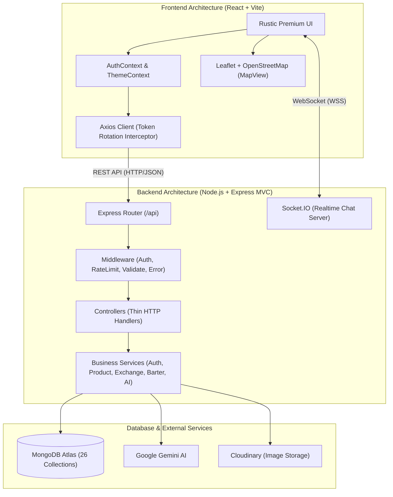

# ROOTLY HOMEGROWN PRODUCE EXCHANGE — PROJECT ARCHITECTURE

## 1. System Overview

Rootly is built as a decoupled, full-stack MVC application supporting hyperlocal produce trade, community barter, harvest prebooking, and neighborhood connection.

---

## 2. Backend MVC Foundation

- **`config/`**: Centralized configuration management (`env.js`, `db.js`, `cloudinary.js`, `gemini.js`). Validates critical production environment variables at startup.
- **`models/`**: Exactly 26 Mongoose models covering Authentication, Marketplace, Harvest, Community, Administration, and AI/Sustainability.
- **`middleware/`**:
  - `authMiddleware.js`: Extracts Bearer token or HttpOnly cookie, verifies JWT against secrets, checks user account status.
  - `adminMiddleware.js`: Server-side enforcement of `req.user.role === 'ADMIN'`.
  - `rateLimitMiddleware.js`: Protects authentication and AI endpoints against abuse.
  - `validateMiddleware.js`: Validates input before reaching controllers.
  - `errorMiddleware.js`: Centralized error normalization (ApiError, Mongoose 11000 duplicate key, CastError, JWT errors).
- **`controllers/`**: Thin request/response orchestration using `asyncHandler` and `sendResponse`.
- **`services/`**: Pure business logic reusable across REST controllers, background jobs, and WebSocket events.
- **`sockets/`**: Socket.IO connection and room management for real-time messaging.

---

## 3. Authentication & Security Design

1. **Role Enforcement**:
   - Only `USER` and `ADMIN` roles exist.
   - Public registration strictly enforces `role: 'USER'` automatically on the server.
   - Client requests attempting to submit `role: 'ADMIN'` have that property stripped.
2. **Password Security**:
   - Passwords hashed with `bcryptjs` using 12 salt rounds.
   - Plaintext passwords are never stored, logged, or serialized.
   - `toSafeObject()` method strips `passwordHash` on all user query returns.
3. **Session Security & Refresh Token Rotation**:
   - Access tokens have short lifespans (15 minutes).
   - Refresh tokens are stored in MongoDB as cryptographic SHA-256 hashes (`tokenHash`).
   - Every refresh request invalidates the previous session and generates a new token pair.
   - Password reset immediately invalidates all active sessions for the user.
4. **Geospatial Privacy**:
   - Exact home coordinates are strictly hidden from public endpoints.
   - Public discovery returns approximate coordinates (`approximateCoords`) with 500m jitter.
   - Exact pickup address is only revealed to confirmed participants of an accepted exchange.

---

## 4. Design System & Frontend Architecture

### Visual Theme: Rustic Premium
- **Olive Forest (`#3E5035`)**: Primary brand color representing healthy garden foliage.
- **Terracotta (`#C8754D`)**: Warm earthy accent used for barter actions and calls to action.
- **Sand (`#E9D8B9`) & Cream (`#F7F0E3`)**: Warm neutral backgrounds conveying warmth.
- **Earth Brown (`#795640`)**: Secondary copy and natural accents.
- **Soft Sage (`#A5AD91`)**: Soft tag accents.
- **Deep Bark (`#282B24`)**: Dark theme background and deep text.
- **Warm White (`#FFFDF8`)**: Card backgrounds.

### Typography
- **Headings**: `Cormorant Garamond` (classic editorial, warm agricultural aesthetic).
- **Body & UI**: `DM Sans` (clean, accessible, highly legible sans-serif).
- **Malayalam**: `Gayathri` and `Noto Sans Malayalam` for authentic regional script representation.

---

## 5. Map & Geospatial Implementation

- **Map Engine**: Leaflet with React Leaflet.
- **Tile Provider**: OpenStreetMap standard raster tiles with full attribution.
- **Coordinate Conversion Rule**:
  - MongoDB GeoJSON format: `[longitude, latitude]`
  - Leaflet format: `[latitude, longitude]`
  - Converted cleanly in `MapView.jsx` and `LocationPicker.jsx`.
- **Marker Color Encoding**:
  - Olive: Ordinary produce for sale.
  - Terracotta: Barter produce.
  - Sage: Free community produce.
  - Gold: Upcoming harvests.
  - User Pin: Live geolocation with animated radius pulse.
