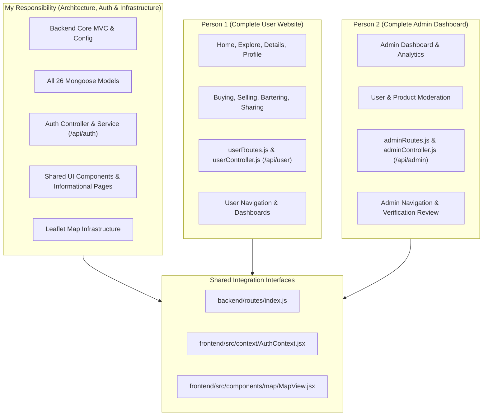

# ROOTLY HOMEGROWN PRODUCE EXCHANGE — TEAM FILE OWNERSHIP

This document establishes the strict boundaries, file ownership, and integration conventions among the three developers working on Rootly.

---

## 1. Ownership Roster & Roles

---

## 2. Detailed File Ownership Mapping

### My Files (Foundation, Auth, Shared Core)
- **Backend Configuration**:
  - `backend/config/db.js`
  - `backend/config/env.js`
  - `backend/config/cloudinary.js`
  - `backend/config/gemini.js`
- **All 26 Mongoose Models**:
  - `backend/models/*.js`
  - `backend/models/index.js`
- **Authentication**:
  - `backend/routes/authRoutes.js`
  - `backend/controllers/authController.js`
  - `backend/services/authService.js`
  - `backend/services/emailService.js`
  - `backend/validators/authValidators.js`
- **Shared Middleware & Utilities**:
  - `backend/middleware/*.js`
  - `backend/utils/*.js`
  - `backend/sockets/chatSocket.js`
  - `backend/app.js`
  - `backend/server.js`
- **Shared Business Services**:
  - `backend/services/productService.js`
  - `backend/services/exchangeService.js`
  - `backend/services/barterService.js`
  - `backend/services/harvestService.js`
  - `backend/services/prebookingService.js`
  - `backend/services/chatService.js`
  - `backend/services/notificationService.js`
  - `backend/services/reviewService.js`
  - `backend/services/reportService.js`
  - `backend/services/verificationService.js`
  - `backend/services/sustainabilityService.js`
  - `backend/services/adminService.js`
  - `backend/services/ai/*.js`
- **Frontend Shared Infrastructure**:
  - `frontend/src/api/apiClient.js`
  - `frontend/src/api/authApi.js`
  - `frontend/src/context/AuthContext.jsx`
  - `frontend/src/context/ThemeContext.jsx`
  - `frontend/src/routes/ProtectedRoute.jsx`
  - `frontend/src/routes/RoleBasedRoute.jsx`
  - `frontend/src/styles/*.css`
  - `frontend/src/components/common/*.jsx` (Button, Input, Modal, ConfirmDialog, LoadingSpinner, ErrorMessage, EmptyState, Toast)
  - `frontend/src/components/map/*.jsx` (MapView, MapMarker, MapPopup, UserLocationMarker, LocationPicker, MapControls)
  - `frontend/src/components/layout/*.jsx` (Navbar, Footer)
  - `frontend/src/pages/auth/*.jsx` (LoginPage, ForgotPasswordPage, ResetPasswordPage)
  - `frontend/src/pages/common/*.jsx` (About, HowItWorks, Help, Contact, Privacy, Terms, Unauthorized, NotFound)

### Person 1's Files (Complete User Website)
- `backend/routes/userRoutes.js`
- `backend/controllers/userController.js`
- User-facing frontend pages:
  - Home Page (`frontend/src/pages/user/HomePage.jsx`)
  - User Dashboard (`frontend/src/pages/user/DashboardPage.jsx`)
  - Explore Page & Map View (`frontend/src/pages/user/ExplorePage.jsx`)
  - Product Listing Creation (`frontend/src/pages/user/CreateListingPage.jsx`)
  - Product Details Page (`frontend/src/pages/user/ProductDetailPage.jsx`)
  - Barter & Prebooking Workflows
  - User Profile & Garden Management
  - User Navigation & Notifications Bell

*Integration Rule: Person 1 mounts their routes through `/api/user` and imports existing services (`productService`, `exchangeService`, `barterService`, `harvestService`, `chatService`).*

### Person 2's Files (Complete Admin Dashboard)
- `backend/routes/adminRoutes.js`
- `backend/controllers/adminController.js`
- Admin-facing frontend pages:
  - Admin Dashboard (`frontend/src/pages/admin/AdminDashboardPage.jsx`)
  - User Moderation (`frontend/src/pages/admin/UserManagementPage.jsx`)
  - Content Moderation & Reports (`frontend/src/pages/admin/ReportsPage.jsx`)
  - Garden Verification Queue (`frontend/src/pages/admin/VerificationsPage.jsx`)
  - Audit Logs & System Settings

*Integration Rule: Person 2 mounts their routes through `/api/admin` and imports existing services (`adminService`, `reportService`, `verificationService`). All admin routes are protected by `authenticate` and `requireAdmin`.*

### Shared Integration Files
- `backend/routes/index.js` (Root router mounting `/api/auth`, `/api/user`, `/api/admin`)
- `frontend/src/App.jsx` (Root React router configuration)
- `README.md` & Root Documentation

---

## 3. Collaboration Rules
1. Never overwrite another teammate's files.
2. Person 1 and Person 2 should not implement their own duplicate authentication systems or database models; use the shared 26 models and `useAuth()`.
3. If an endpoint contract needs modification, discuss via integration request rather than breaking established schemas.
